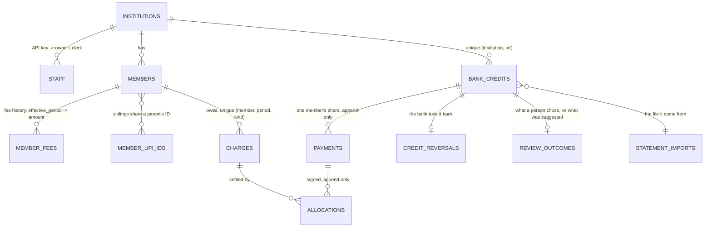
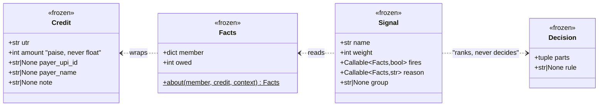
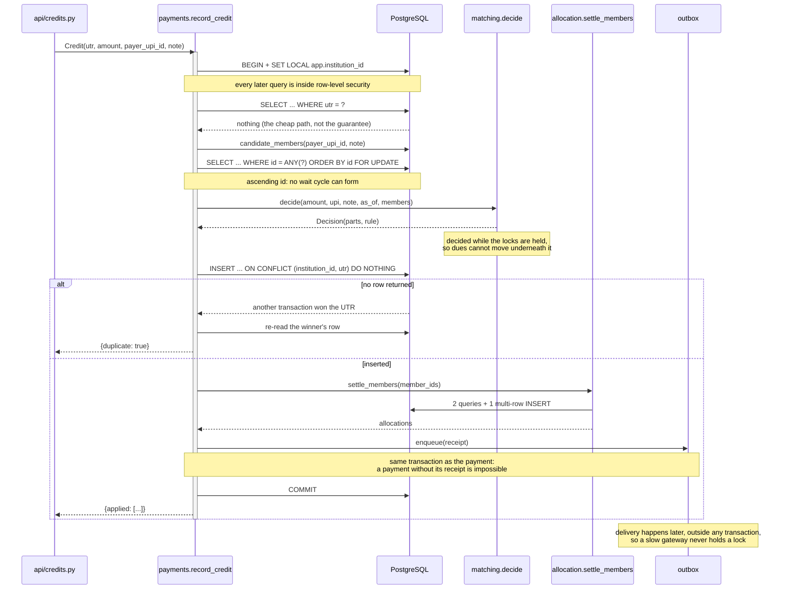

# PaySleuth

[](https://github.com/SrijaMalhar/PaySleuth/actions/workflows/ci.yml)

Fee reconciliation for tuition centres, PGs and housing societies. It reads the bank statement they
already get, decides which member each UPI transfer belongs to, applies it to what they owe, sends
receipts and reminders — and tells the owner when the statement itself is missing a line. It never moves
money and never touches a payment network.

The CRUD here is an afternoon's work. The design problem is that the input is partial, repeated and
adversarially messy, the output is **money attributed to a named family**, and **a wrong attribution is
worse than no attribution** — the family that paid gets a reminder they do not deserve, and the family
that did not stops paying. Three real statement lines, and what each one costs:

```
UPI-R K VERMA-rk.verma@okhdfcbank-HDFC0001234-615412345602-JUNE FEES
      one transfer, two children -> split by what each owes at that instant

UPI/CR/615412345604/LAKSHMI IYER/UBIN/lakshmi.iyer@oksbi/meera fees
      a UPI ID nobody registered -> rank it, explain it, never apply it

BY TRANSFER-UPI/CR/615412345601/SUNITA S/SBIN/sunita.sha/June fees--
      SBI truncates the name and the UPI ID -> neither may be stored as the payer's
```

So: no stored balances, append-only money, one lock order, seven idempotency keys, and a system built to
refuse rather than guess.

## It runs

`python -m tools.walkthrough` — billing, an import that decides what it can and refuses what it cannot,
the queue a person works, one credit delivered twenty times at once, and a statement line that never
became a row. Real output, against a real PostgreSQL, into a throwaway schema.


The last beat is the one to watch. The bank printed ₹12,000, nothing in the books corresponds to it, and
summing what landed would have balanced perfectly — because a lost line is absent from *both* sides of
the arithmetic. Catching it needs a third question, asked of the database rather than of the importer.

| | |
|---|---|
| **447 tests, zero mocks** | every one against a real PostgreSQL in its own schema, because locks, constraints and row-level security *are* the subject |
| **32/32 mutations caught** | each safety mechanism deleted one at a time; the test that covers it must go red |
| **9 concurrency races** | real threads released on a barrier — and where an interleaving matters it is *forced* by polling `pg_stat_activity`, not hoped for |
| **1 fingerprint, 4 worker counts** | parallel import produces books that hash identically to a serial import; equivalence tested at 1, 4, 8 and 16 workers |
| **12 bugs, listed by name** | including the one where a feature's headline claim in this README was false |
| **10 layers, asserted** | `test_architecture.py` reads the AST import graph: acyclic, pure layer closed, HTTP confined to one package |

Python 3.12 · FastAPI · PostgreSQL 16 · psycopg 3 · no ORM · 4,800 lines of application code, a 345-line
schema, 5,200 lines of tests.

---

## Domain model

Eighteen tables. The ones money moves through:



**There is no edge from `members` to a balance**, and that absence is the design. `outstanding` is
`SUM(charges) − SUM(allocations)`, computed on demand. A stored balance is a cache of a sum, and every
cache needs invalidation — under twenty copies of one bank alert, a billing run and a correction at the
same instant, an incremented counter is where the money bug lives. Deriving it means a lost update can
corrupt *a row*, never *the answer*.

The cost is that every balance read is an aggregate. It is bounded by never doing one in a loop:
`settle_members()` and `balances_with_details()` take a list and answer in one query each, and
`tests/test_performance.py` holds the query count per credit to a constant so a per-member loop cannot
creep back in.

`payments` and `allocations` are append-only, enforced by triggers rather than convention. A correction
is a new row with a negative amount pointing at what it undoes — so a disputed payment's history is
readable in the table itself, which is what you want the first time a parent says "I did pay in May".

Amounts are integer paise, parsed once with `Decimal` at the edge and formatted back to a string there;
no float ever touches money, because `int(0.29 * 100)` is 28. Billing months are zero-padded strings, so
`"2026-09" < "2026-10"` is a plain comparison PostgreSQL can index.

## The object model

The pure layer — everything testable with no database — is frozen dataclasses. These four are the
matching path, from what the bank said to what gets written; `StatementRow` and `Continuity` carry the
parsing side and are covered in [docs/concurrency.md](docs/concurrency.md).

An empty `Decision.parts` is the review queue: refusing is a value, not an exception.



`Signal` is the one to look at. A reason to believe a credit belongs to a member is **one value** carrying
its weight, its predicate and its explanation together — not a method, not a branch. `SIGNALS` is a tuple
of them and `WEIGHTS` is derived from it, so a new reason is one entry.

`Facts` keeps a promise about complexity: a signal receives facts, never a connection. That is what holds
the scoring pass at four queries however many signals exist, and it is enforced structurally — there is no
`conn` in scope to reach for.

Not classes elsewhere: each module is a namespace of functions over `(conn, institution_id, …)`, because
the unit of consistency is a transaction and an object owning a connection invites a caller to use it
outside one — which is how a lock ends up held across a network call.

```python
def record_credit(conn, inst: int, credit: Credit) -> dict
def decide(conn, amount, payer_upi_id, note, as_of, *, members, source) -> Decision
def settle_members(conn, inst: int, member_ids) -> list[dict]      # a list, so forty members are 2 queries

@contextmanager
def tenant_tx(conn, institution_id: int)        # SET LOCAL app.institution_id; fails closed
def lock_members(conn, member_ids) -> list[int] # sorts ascending: the deadlock argument
```

## Invariants, and where they live

The interesting question is not what they are but **which layer enforces each one**, because that decides
what a bug can do.

| Invariant | Enforced by | Why there |
|---|---|---|
| A month is billed once per member | `UNIQUE (member_id, period, kind)` | Two concurrent billing runs must not double-bill; only the database sees both |
| One bank credit is recorded once | `UNIQUE (institution_id, utr)` | Same reason, and the key comes from the bank |
| A credit is reversed at most once | `UNIQUE` on `credit_reversals.bank_credit_id` | A retried click must be a no-op |
| A payment is voided at most once | Partial unique index on `payments.reverses_id` | Two corrections must not both take the same money back |
| Money rows are never changed or deleted | `BEFORE UPDATE OR DELETE` triggers on `payments` and `allocations` | A future careless `UPDATE` anywhere, including a psql session, has to fail |
| Nobody approves their own correction | `CHECK (decided_by <> requested_by)` | The control has to survive a bug in the code above it |
| A tenant sees only its own rows | `FORCE`d row-level security on 16 tables, keyed on `app.institution_id` | A forgotten `WHERE` clause becomes a no-op rather than a leak |
| `amount = gross - concession` | `CHECK` on `charges` | Arithmetic stated once, next to the data |
| No charge is over-allocated | Code (`settle_members` allocates `min(unspent, unpaid)`) + checked after every step by the property test | Needs the current sums, which a row constraint cannot see |
| Nobody holds unused money while owing | Code, same place | Same |
| Every credit a statement printed is in the books | `close.check_credits_landed`, which queries the books | Spans a file and a table; cannot be a constraint |

Everything a constraint *can* express is a constraint. The three that cannot are re-checked by the
Hypothesis property test after every single operation.

Tenancy runs through `tenant_tx`, which does `SET LOCAL app.institution_id` — transaction-local, so it
cannot leak to the next request on a pooled connection, and with nothing set the policy matches no rows.
It fails closed. `check_role()` refuses to start as a role with `SUPERUSER` or `BYPASSRLS`, which is what
stops a managed provider's owner role from silently skipping every policy.

## The critical path

One credit arriving is the whole system in miniature. The order of the first four steps is the design.



1. **Tenancy before anything.** `SET LOCAL` cannot leak to the next request; unset matches nothing.
2. **Lock before deciding.** A sibling split divides by what each child owes *right now*; deciding first
   would let a concurrent payment change the answer underneath it.
3. **Decide before inserting.** The row is written once with the status it ends up in, so `needs_review`
   is never a transient state a reader can observe.
4. **The constraint is the guarantee.** The `SELECT` at the top is an optimisation for the common
   re-import — two transactions can both see "no row". `ON CONFLICT DO NOTHING` returning nothing is the
   real duplicate detection.

Every money operation takes locks in the same order: approval row, then credit row, then member rows **in
ascending id order**. That ordering is the whole deadlock argument — if every transaction takes the lower
id first, no wait cycle can form. The alternative, locking "from then to" when moving money, deadlocks the
moment one clerk moves money from Diya to Kabir while another moves different money the other way.
`lock_members()` is the only place that takes a member lock, and it sorts. → **[docs/concurrency.md](docs/concurrency.md)**

`decide()` is those five rules, in order, and they are a closed list rather than a plugin registry
because they are what spends money without a human — they should be readable top to bottom on one screen
and changed with intent, not discovered at import time:

1. Exactly one reference code (`PS1004`) in the note → that member.
2. Several codes, and the amount equals exactly what they owe together → split by what each owes.
3. A UPI ID registered to exactly one member → that member.
4. A UPI ID shared by siblings, and the amount equals their dues or fees together → split. Never a ₹0
   share, so a sibling on a full scholarship goes to review instead.
5. Anything else → the review queue, with ranked suggestions that are shown and never applied.

## Idempotency: seven keys for seven questions

"Make it idempotent" is not one decision. Each repeated action has its own natural key, and choosing the
wrong one is how a system double-charges.

| Repeated action | Key | Whose key is it |
|---|---|---|
| The same credit arrives again | `(institution_id, utr)` | **The bank's.** Ours would differ between the alert and the statement |
| The same statement file is uploaded again | `(institution_id, file_sha256)` | Content, so a renamed file is still the same file |
| A month is billed again | `(member_id, period, kind)` | The domain's own identity for a charge |
| A reminder stage is queued again | `reminder:<charge>:<stage>` | Composite, so a job that did not run for a week sends one reminder, not three |
| A message is delivered twice | `message_id` in the payload | **The gateway's** problem to dedupe; delivery is at-least-once by design |
| A member edit is submitted twice | `version`, as an HTTP ETag | Optimistic locking: the second gets 412, not a silent overwrite |
| A correction is applied twice | `payments.reverses_id` unique | Money can be taken back once |

An eighth is the transport's rather than the domain's: a client may send `Idempotency-Key` on any mutating
request and get the first reply back. It exists because `POST /members` has no natural identity — two
students called Diya Sharma are two students — and a client that timed out cannot tell a lost request from
a lost response.

Outgoing messages are signed `X-PaySleuth-Signature: t=<unix>,v1=<hex HMAC-SHA256>` over
`"<t>.<body bytes>"` — signing the timestamp *with* the body is what stops a captured message being
replayed with a fresh `t`. Logs are one JSON object per line with phone numbers and UPI IDs masked in a
filter on the handler, so a line added later anywhere is masked without the author remembering. Every
caller gets a token bucket: 120 a minute, burst 30, refused with `429` and a `Retry-After` a client can
trust.

API keys are hashed with SHA-256 rather than a slow KDF, deliberately: a work factor defends secrets
*people choose*, and a key here is 32 bytes of CSPRNG output. The argument rests on the entropy rather than
the hash, so `tests/test_api_keys.py` asserts the entropy and a mutation that shortens a key turns it red.

## Module structure

Ten layers, acyclic, dependencies pointing one way.


Three rules hold the shape, and `tests/test_architecture.py` reads the import graph out of the source and
asserts each one, because a layering that exists only in a README stops being true on the first busy
afternoon:

1. **No cycles.** Every module is understandable, and testable, without its callers.
2. **The pure layer is closed.** Money, time, name matching, statement parsing and the bank adapters
   depend only on each other, so a statement can be parsed and balance-checked with no connection.
3. **The web layer is a sink.** HTTP lives only in `api/`, and nothing in the domain imports it — which is
   what lets the worker, the CLI and the tests call the same functions with no request in sight.

Behaviour that varies is injected: `create_app(dsn, send, today=…, now=…)` takes the message sender and the
clock, which is why the API tests run against a real HTTP server with a fixed date and a fake gateway and
no monkeypatching.

## How correctness is established

Six layers, each catching what the one above cannot:

1. **Unit and integration tests** — the cases I thought of.
2. **A Hypothesis state machine** — the ones I did not. It chooses the operations and re-checks every
   invariant after **every step**. The value over a random loop is shrinking: a bug that used to fail at
   "seed 3, step 41" now reduces to one line.
3. **Concurrency tests** — real threads on a barrier, with the bad interleaving *forced*.
4. **Equivalence testing** — parallel import against a serial baseline at four worker counts, the whole
   set of books hashed to one fingerprint.
5. **Mutation testing** — one safety mechanism deleted at a time, 32/32 caught. This is the layer that
   answers "do your tests actually test that?" It has twice failed a mechanism that was correct and a test
   that was not — the rate limiter's lock survived deletion because the test passed about one run in three
   without it, and a test that flaky is worse than none.
6. **Architecture tests** — the import graph assertions above.

**The one I would raise myself.** The daily close's whole claim was *"PaySleuth notices when data is
missing, not just when it's wrong"* — and it was false in its own case. It summed `bank_credits`, so a
statement line that never became a row was absent from both sides: ₹12,000 of real credits vanished and
the close reported `clean`. I had written the sentence before building the check. The fix asks the
database instead of trusting the importer, and three more holes turned up inside the fix, which is why
that check now has four tests and two mutation cases pointed at it.

→ **[docs/correctness.md](docs/correctness.md)** has all 32 mutations and the 12 real bugs, each named with
the layer that caught it.

---

**Running it:** [local setup](docs/running.md) · [deploying and running a pilot](docs/deploying.md) ·
[what this does not do](docs/limits.md)

**Deeper:** [concurrency](docs/concurrency.md) · [how correctness is established](docs/correctness.md) ·
[design notes](docs/design-notes.md) · [performance](docs/performance.md) ·
[parallel import equivalence](docs/parallel-import.md)
