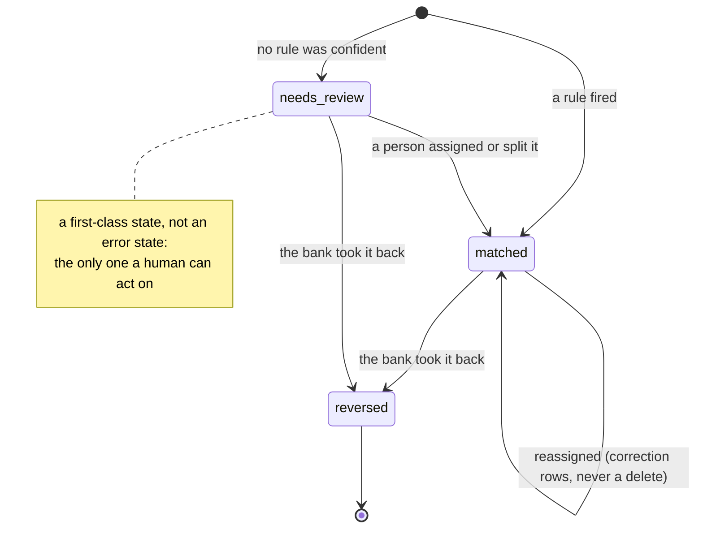
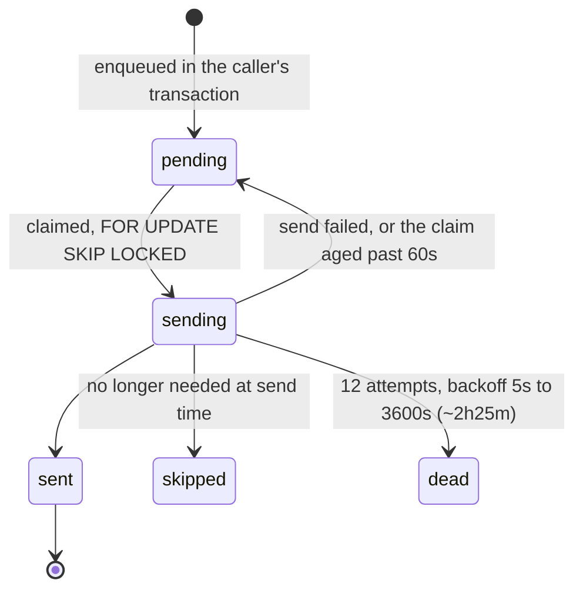

# Design notes

The reasoning behind the shape, kept out of the [README](../README.md) so that page stays the thing you
can read in five minutes. State machines, what it takes to extend each part, the principles the code
actually follows, and the trade-offs with their costs named.

## State machines

**A bank credit** — the only state that matters to money.



**An outbox message** — the delivery contract, written as states.



The 60-second visibility timeout is what makes a crashed worker recoverable without a separate reaper: a
claim older than that is simply claimable again. Backoff reaching its cap before the attempt limit is
deliberate — with eight attempts the 3600s ceiling was unreachable, which made it a lie in the config.

**An approval request** is `pending -> approved | rejected`, decided by someone other than the requester,
with `CHECK ((status = 'pending') = (decided_by IS NULL))` so there is no half-decided row.

**A charge's payment state** is *derived*, not stored: `unpaid`, `partially_paid`, `paid` are read from
`amount` against `SUM(allocations)`. Same reasoning as balances — a state column would be a cache, and a
cache needs invalidation.

## Extension points

The LLD question is "what does it take to add one?" Each of these is one declaration.

**A new bank's statement layout** — one module in `paysleuth/banks/` exporting `NAME`, `HEADER` and
`narration(text)`, added to the `BANKS` tuple. Nothing in `statements.py` changes; `banks.detect()` picks
it by header, and unknown layouts fall back to the generic patterns.

**A new suggestion signal** — one `Signal` entry carrying its weight, when it fires and how it reads to the
owner, over a `Facts` object computed once per member:

```python
Signal("note_says_urgent", 50,
       fires=lambda f: "URGENT" in tokens(f.credit.get("note")),
       reason=lambda f: "the note says urgent")
```

`WEIGHTS` is derived from the table, so the surface the tuner uses stays in step automatically. Mutually
exclusive signals declare a `group`, so "equals the fee" cannot also score "a whole number of months of the
fee" for the same rupees. A signal receives facts rather than a connection — which is what keeps the
scoring pass at four queries however many signals exist. There is a test that declares a new signal at
runtime and watches the review queue score and explain it.

**A new message kind** — add it to the `outbox.kind` CHECK and enqueue it in the transaction that causes it;
the relay delivers it with the retry, ordering and quiet-hours behaviour already in place.

What is deliberately *not* an extension point: the five automatic rules are a closed, ordered list rather
than a plugin registry. They decide where money goes without a human, so they should be readable top to
bottom on one screen and changed with intent, not discovered at import time.

## Design principles, and the line of code each one is

Named, because a reviewer should not have to infer them — and tied to something checkable, because a
principle you cannot point at is a principle you are not following.

| Principle | Where it is | What would break without it |
|---|---|---|
| **Single responsibility** | One module per concern, ten acyclic layers, asserted from the AST by `test_architecture.py` | The layering stops being true on the first busy afternoon, and nobody notices |
| **Open/closed** | `SIGNALS` is a tuple of `Signal` values; `BANKS` a tuple of adapters. A new reason or a new bank is one entry — no existing function changes | Every new bank adds a branch to the parser, and the parser becomes the file nobody will touch |
| **Liskov substitution** | Every bank adapter satisfies the same three names (`NAME`, `HEADER`, `narration`), and the generic fallback is one of them | `detect()` would need to know which adapters are "real", and the fallback would be a special case forever |
| **Interface segregation** | A signal receives `Facts`, not a connection. There is no `conn` in scope for it to reach for | A signal could issue a query, and the scoring pass would go from 4 queries to 4 + N |
| **Dependency inversion** | `create_app(dsn, send, today=…, now=…)` injects the gateway and the clock onto `app.state`, and `api/deps.py` reads them back. Business code raises `NotFound`/`Conflict`; only the api package knows those are 404 and 409 | Tests monkeypatch modules, and the worker and CLI cannot call the same functions |
| **Fail closed** | RLS with nothing set matches no rows; `check_role()` refuses to start as a role that bypasses it | A forgotten `WHERE` becomes a leak instead of a no-op |
| **Make illegal states unrepresentable** | `CHECK ((status = 'pending') = (decided_by IS NULL))`; `CHECK (decided_by <> requested_by)`; append-only triggers | A half-decided approval, or a self-approved correction, is reachable from any code path |
| **Primitive obsession, avoided** | Paise as `int` with `Decimal` only at the edge; periods as zero-padded `str`; `Credit`, `Decision`, `Facts` as frozen types | `int(0.29 * 100)` is 28, and `"2026-9" < "2026-10"` is false |

Two places this code deliberately departs from the textbook, and the reasons I would give:

**No service classes.** Each module is a namespace of functions over `(conn, institution_id, …)` rather
than a `PaymentService` holding a connection. The unit of consistency here is a transaction, and an object
that owns a connection invites a second caller to use it outside one — which is exactly how a lock gets
held across a network call. Passing the connection makes the transaction boundary visible at every call
site.

**No repository layer.** The hard parts are `FOR UPDATE SKIP LOCKED`, partial unique indexes,
`INSERT … ON CONFLICT`, `FILTER` aggregates and row-level security. A repository abstraction over those
would either leak them all or hide the locking, and the locking is the thing I most need to reason about.
The cost I accept: SQL is spread across modules rather than centralised, and swapping databases would be
a rewrite rather than a reimplementation. For a system whose correctness *is* PostgreSQL's concurrency
semantics, that trade is the right way round.

## Patterns used, and patterns refused

| Pattern | Where | Why |
|---|---|---|
| Transactional outbox | `outbox.py` | A receipt row is inserted in the payment's own transaction, so a payment without its receipt is impossible. Delivery then happens outside any transaction, so a slow gateway never holds a lock |
| Strategy, as a data table | `matching.SIGNALS`, `banks.BANKS` | Each variant is one declaration instead of a branch in three functions |
| Value objects (frozen dataclasses) | `Credit`, `Decision`, `Facts`, `Signal`, `Bank`, `Continuity`, `StatementRow`, `Actor` | A fact from the bank should not be mutable after parsing |
| Append-only ledger with correction rows | `payments`, `allocations` | Money history is evidence. Corrections are new rows, enforced by triggers |
| Optimistic locking | `members.version` → ETag | Human edits are long-lived and rarely conflict; pessimistic locking across a form fill is wrong |
| Pessimistic row locks | money operations | Machine writes are short and *do* conflict |
| Claim-check queue | `FOR UPDATE SKIP LOCKED` + visibility timeout | A small queue with the properties of a real one, without another system to run |
| Context variable for the actor | `actors.current_actor` | The audit log records who acted without every money function taking a `who` parameter it does not use |

Refused, with reasons I would defend:

- **No ORM, no repository layer.** Covered above: the mapping layer would obscure the locking.
- **No Kafka, no microservices.** A 500-student centre generates a few thousand rows a month. One
  PostgreSQL does transactional outbox, queueing, tenancy and reporting here. Choosing not to use Kafka
  and being able to say why is a better answer than using it.
- **No ML matching.** In money, a rule that can be explained to the owner beats a model that cannot. The
  review queue *ranks* with weights, but ranking is a suggestion shown to a person; the five automatic
  rules are deterministic and readable.
- **No stored balances, no denormalised counters.** Every cache needs invalidation, and invalidation
  under concurrency is where the money bug lives.
- **No soft-delete flag on money.** `payments` and `allocations` are append-only, so a correction is a new
  signed row rather than a hidden one.

## Trade-offs, and what I would change at ten times the size


| Decision | Cost I accepted |
|---|---|
| Derive balances instead of storing them | Every read is an aggregate. Bounded by scale, held by query-count tests |
| Append-only money with correction rows | More rows, and every reader must sum rather than select. Bought: no money record can be lost |
| Pessimistic row locks on the money path | Writes to one member serialise (183/s measured vs 520/s across members). Bought: no lost update, and a deadlock argument I can state in one sentence |
| Thread pool, not processes, for import | Bounded by the GIL for CPU work. Fine here, because the time is spent waiting on PostgreSQL |
| Grouping the whole statement in memory | A single upload must fit in memory. True at a few thousand lines; stated as a limit |
| Five closed matching rules, not a plugin registry | Adding a rule means editing a function. Deliberate: these spend money without a human |

At ten times the size I would keep the rule and change where it lives: partition by member id with each
partition handled in statement order, which is the same idea with groups decided up front instead of
discovered. What I would not change is the proof — the equivalence test keyed on business identity is what
let me make the thing faster twice without wondering whether the books had moved.

What I would reach for first, in order: a read replica for reports (the only unbounded reads);
`NOTIFY`/`LISTEN` to wake the relay instead of a 5-second poll; and a second institution's real
statements, because the honest number for auto-match rate is still "unmeasured".
